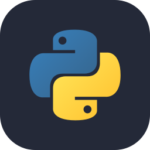
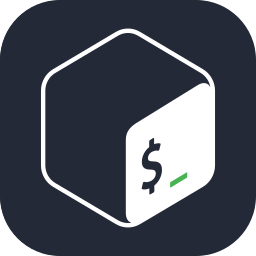
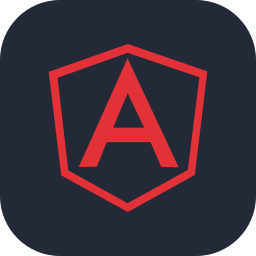
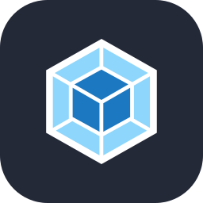
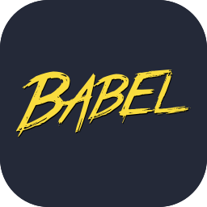
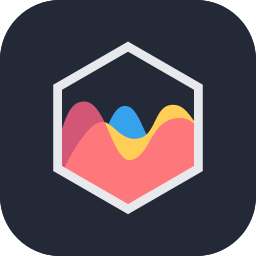
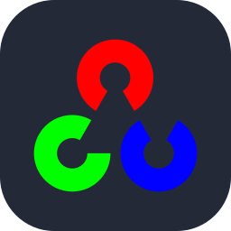
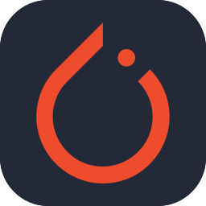
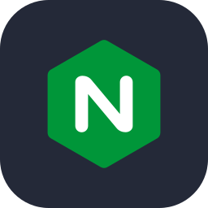

## Taehong Kim

Backend, web and mobile developer, 22 years.

- Product development from design to operation: backend, web, mobile apps and the servers under them
- An in-house layer on Django ORM, Sanic, React and Ionic, where a class name sets the table, API route, page path and selector
- Audio and media: tempo and key extraction, phase-vocoder time stretching, SVG score rendering, a VST sampler, audio fingerprinting, HLS and WebRTC pipelines for live, VOD and multi-view 4K
- Services built for traffic spikes such as celebrity fan-meeting ticket openings, with nginx configs and deploy tooling written in-house, on-prem or cloud

### Projects

| | |
|---|---|
| **[PyMusicPlayer](https://github.com/peppy0510/PyMusicPlayer)** | Desktop music player with tempo/key detection, highlight-only playback and a spectrum visualizer |
| **[wsl-service](https://github.com/peppy0510/wsl-service)** | Starts WSL services when Windows boots |
| **[PyWinLayout](https://github.com/peppy0510/PyWinLayout)** | Window layout switching by hotkey |
| **[zsh-venv-auto](https://github.com/peppy0510/zsh-venv-auto)** · **[pwsh-venv-auto](https://github.com/peppy0510/pwsh-venv-auto)** | Auto-activates Python venvs on directory change |

Most other repositories are small Windows utilities.

### Background

- MS in multimedia signal processing
- 3 patents (2 PCT), 4 papers, 12 government-funded R&D projects, 3 funding rounds
- Started with BASIC on an Apple II, ran an MP3 download site in the late '90s, and worked on music and electronic instruments before studying acoustic signal processing

**[muteklab.com](https://muteklab.com)**

### Tools

| | |
|---|---|
| **Languages** |         |
| **Backend** |      |
| **Frontend** |           |
| **Mobile · Desktop** |      |
| **Data · Search** |         |
| **Media · Signal** |        |
| **Infra** |           |
| **Tools** |         |

<b>한국어</b>

 

백엔드·웹·모바일 개발 22년 차입니다.

- 설계부터 운영까지 맡는 제품 개발: 백엔드, 웹, 모바일 앱과 그 아래 서버
- Django ORM, Sanic, React, Ionic 위에 직접 만든 층: 클래스 이름 하나로 테이블, API 경로, 화면 경로, 셀렉터가 정해짐
- 오디오·미디어: 템포·조성 추출, Phase Vocoder 타임 스트레칭, SVG 악보 렌더링, VST 샘플러, 오디오 핑거프린팅, 라이브·VOD·다시점 4K 용 HLS·WebRTC 파이프라인
- 셀럽 팬미팅 티켓 오픈처럼 트래픽이 한꺼번에 몰리는 서비스 구축·운영, nginx 설정과 배포 도구 직접 작성, 온프레미스·클라우드 모두

### 프로젝트

| | |
|---|---|
| **[PyMusicPlayer](https://github.com/peppy0510/PyMusicPlayer)** | 데스크톱 음악 플레이어. 템포·조성 추출, 하이라이트 구간 연속 재생, 스펙트럼 비주얼라이저 |
| **[wsl-service](https://github.com/peppy0510/wsl-service)** | 윈도우 부팅 때 WSL 서비스 자동 시작 |
| **[PyWinLayout](https://github.com/peppy0510/PyWinLayout)** | 단축키로 창 배치 전환 |
| **[zsh-venv-auto](https://github.com/peppy0510/zsh-venv-auto)** · **[pwsh-venv-auto](https://github.com/peppy0510/pwsh-venv-auto)** | 디렉터리 이동 때 파이썬 venv 자동 활성화 |

나머지 저장소는 대부분 작은 윈도우 유틸리티입니다.

### 이력

- 멀티미디어 신호처리 석사
- 특허 3건(PCT 2건), 논문 4편, 국가 R&D 과제 12건, 투자 유치 3회
- Apple II BASIC 으로 시작, 90년대 말 MP3 다운로드 사이트 운영, 음악·전자 악기 작업을 거쳐 음향 신호처리 전공

**[muteklab.com](https://muteklab.com)**

