## Taehong Kim

Backend, web and mobile developer, 22 years, from design through operation.

- Framework: in-house layer on Django ORM, Sanic, React and Ionic, where a class name sets the table, API route, page path and selector
- Audio and media: tempo and key extraction, time stretching, score rendering, VST sampler, audio fingerprinting, HLS and WebRTC streaming
- Operations: high-traffic services, nginx, in-house deploy tooling

### Projects

| | | | |
|---|---|---|---|
| **Audio** |  | **[PyMusicPlayer](https://github.com/peppy0510/PyMusicPlayer)** | Music player with tempo/key detection, highlight playback, DSP and VST plugins |
|  |  | **[PyWinAudio](https://github.com/peppy0510/PyWinAudio)** | Equalizer APO rack: EQ, auto mastering, VST2 plugins, analyzer and mixer |
| **Windows** |  | **[PyWinAgent](https://github.com/peppy0510/PyWinAgent)** | Usage dashboard for Claude Code, Codex and Antigravity, with local text-to-speech |
|  |  | **[PyWinSystem](https://github.com/peppy0510/PyWinSystem)** | System monitor: CPU, GPU, memory, disks, network and processes |
|  |  | **[PyWinClock](https://github.com/peppy0510/PyWinClock)** | Clock, world clock, weather, stopwatch and countdown |
|  |  | **[PyWinLayout](https://github.com/peppy0510/PyWinLayout)** | Window layout switching by hotkey |
|  |  | **[PyWinStartup](https://github.com/peppy0510/PyWinStartup)** | Startup manager that stops or hides unwanted processes |
|  |  | **[PyWinSecure](https://github.com/peppy0510/PyWinSecure)** | Hide or show folders |
| **Dev setup** | 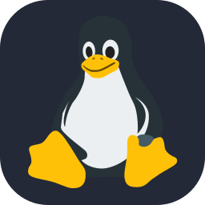 | **[wsl-service](https://github.com/peppy0510/wsl-service)** | Starts WSL services when Windows boots |
|  |   | **[zsh-venv-auto](https://github.com/peppy0510/zsh-venv-auto)** · **[pwsh-venv-auto](https://github.com/peppy0510/pwsh-venv-auto)** | Auto-activates Python venvs on directory change |
|  | 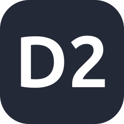 | **[D2CodingNF](https://github.com/peppy0510/D2CodingNF)** | D2Coding with Nerd Font icons, Hangul kept at double width |
|  | 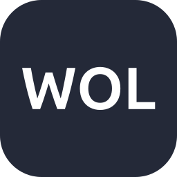 | **[iptime-wol](https://github.com/peppy0510/iptime-wol)** | Wake-on-LAN through an ipTIME router |
| **Editors** |  | **[FormatCode](https://github.com/peppy0510/FormatCode)** | One Sublime Text shortcut for per-language code formatters |
|  |  | **[KoreanInputProcessor](https://github.com/peppy0510/KoreanInputProcessor)** | Korean input for Sublime Text 4 |
|  |  | **[PythonFixRequirements](https://github.com/peppy0510/PythonFixRequirements)** | Sorts and dedupes requirements.txt in Sublime Text |
|  |  | **[vscode-theme-legacypack](https://github.com/peppy0510/vscode-theme-legacypack)** | VS Code colour theme |
| **Python** |  | **[python-somedata](https://github.com/peppy0510/python-somedata)** | Dummy data generator |
|  |  | **[python-dtruct](https://github.com/peppy0510/python-dtruct)** | C++ struct-like dictionary class |

### Background

- MS in multimedia signal processing
- 3 patents (2 PCT), 4 papers, 12 government-funded R&D projects, 3 funding rounds

**[muteklab.com](https://muteklab.com)**

### Tools

| | |
|---|---|
| **Languages** |     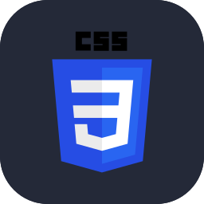 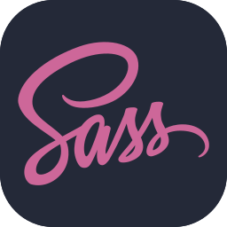   |
| **Backend** |  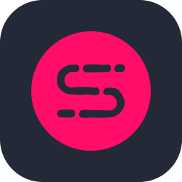    |
| **Frontend** |  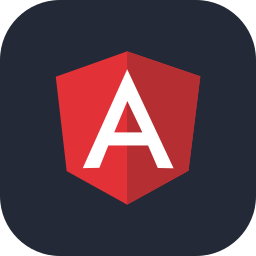       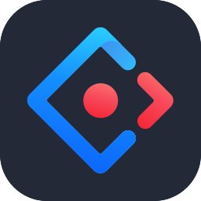  |
| **Mobile · Desktop** | 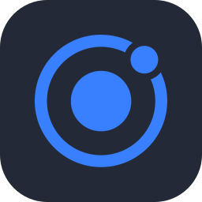  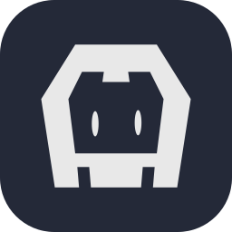  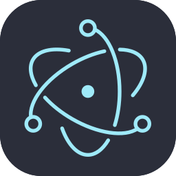 |
| **Data · Search** |    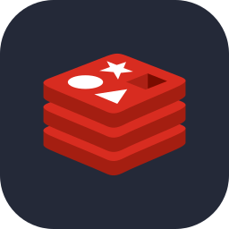  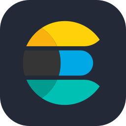 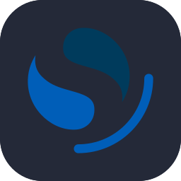  |
| **Media** |   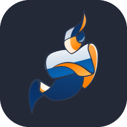 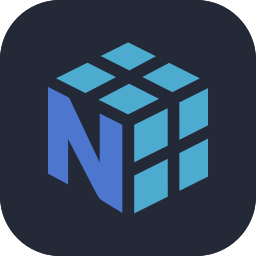 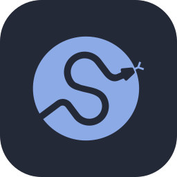 |
| **Audio** |   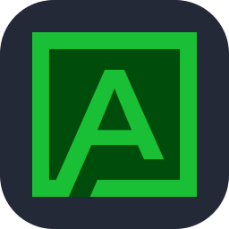 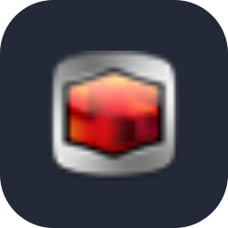 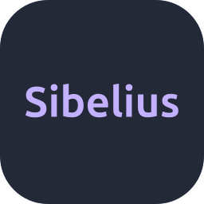 |
| **ML · LLM · VLM** |  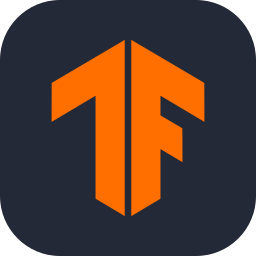 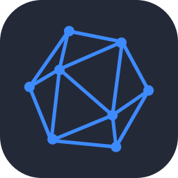 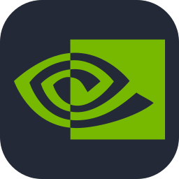     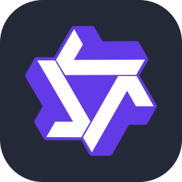 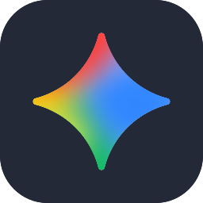  |
| **Infra** |     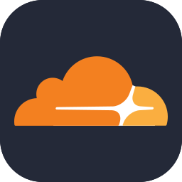  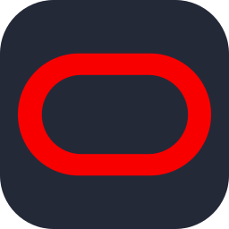 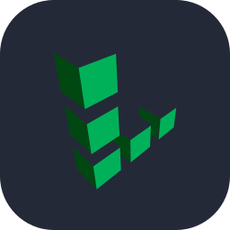 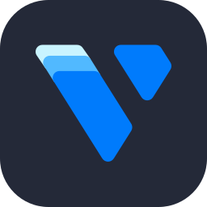   |
| **Tools** |      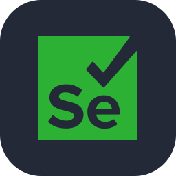  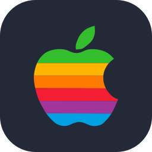 |

<b>한국어</b>

 

백엔드·웹·모바일 개발 22년 차, 설계부터 운영까지 맡습니다.

- 프레임워크: Django ORM, Sanic, React, Ionic 위 자체 층, 클래스 이름 하나로 테이블·API 경로·화면 경로·셀렉터 결정
- 오디오·미디어: 템포·조성 추출, 타임 스트레칭, 악보 렌더링, VST 샘플러, 오디오 핑거프린팅, HLS·WebRTC 스트리밍
- 운영: 대량 트래픽 서비스, nginx, 자체 배포 도구

### 프로젝트

| | | | |
|---|---|---|---|
| **오디오** |  | **[PyMusicPlayer](https://github.com/peppy0510/PyMusicPlayer)** | 템포·조성 추출, 하이라이트 재생, DSP·VST 플러그인을 갖춘 음악 플레이어 |
|  |  | **[PyWinAudio](https://github.com/peppy0510/PyWinAudio)** | Equalizer APO 랙: EQ, 오토 마스터링, VST2 플러그인, 분석기, 믹서 |
| **윈도우** |  | **[PyWinAgent](https://github.com/peppy0510/PyWinAgent)** | Claude Code·Codex·Antigravity 사용량 대시보드, 로컬 TTS |
|  |  | **[PyWinSystem](https://github.com/peppy0510/PyWinSystem)** | CPU·GPU·메모리·디스크·네트워크·프로세스 모니터 |
|  |  | **[PyWinClock](https://github.com/peppy0510/PyWinClock)** | 시계, 세계 시계, 날씨, 스톱워치, 카운트다운 |
|  |  | **[PyWinLayout](https://github.com/peppy0510/PyWinLayout)** | 단축키로 창 배치 전환 |
|  |  | **[PyWinStartup](https://github.com/peppy0510/PyWinStartup)** | 원치 않는 시작 프로그램 종료·숨김 |
|  |  | **[PyWinSecure](https://github.com/peppy0510/PyWinSecure)** | 폴더 숨기기·보이기 |
| **개발 환경** |  | **[wsl-service](https://github.com/peppy0510/wsl-service)** | 윈도우 부팅 때 WSL 서비스 자동 시작 |
|  |   | **[zsh-venv-auto](https://github.com/peppy0510/zsh-venv-auto)** · **[pwsh-venv-auto](https://github.com/peppy0510/pwsh-venv-auto)** | 디렉터리 이동 때 파이썬 venv 자동 활성화 |
|  |  | **[D2CodingNF](https://github.com/peppy0510/D2CodingNF)** | Nerd Font 아이콘을 넣은 D2Coding, 한글 2칸 폭 유지 |
|  |  | **[iptime-wol](https://github.com/peppy0510/iptime-wol)** | ipTIME 공유기로 Wake-on-LAN |
| **에디터** |  | **[FormatCode](https://github.com/peppy0510/FormatCode)** | Sublime Text 언어별 코드 포맷터를 단축키 하나로 |
|  |  | **[KoreanInputProcessor](https://github.com/peppy0510/KoreanInputProcessor)** | Sublime Text 4 한글 입력 |
|  |  | **[PythonFixRequirements](https://github.com/peppy0510/PythonFixRequirements)** | Sublime Text 에서 requirements.txt 정렬·중복 제거 |
|  |  | **[vscode-theme-legacypack](https://github.com/peppy0510/vscode-theme-legacypack)** | VS Code 색 테마 |
| **파이썬** |  | **[python-somedata](https://github.com/peppy0510/python-somedata)** | 더미 데이터 생성기 |
|  |  | **[python-dtruct](https://github.com/peppy0510/python-dtruct)** | C++ 구조체처럼 쓰는 딕셔너리 클래스 |

### 이력

- 멀티미디어 신호처리 석사
- 특허 3건(PCT 2건), 논문 4편, 국가 R&D 과제 12건, 투자 유치 3회

**[muteklab.com](https://muteklab.com)**

